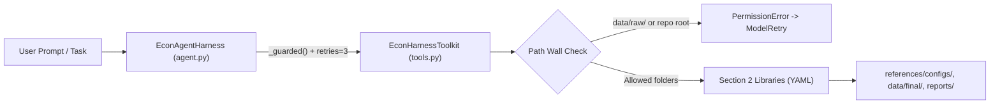

# Pydantic-AI Econ Harness (`econ-agent-harness`)

Minimal, domain-specific agent built on [Pydantic-AI](https://ai.pydantic.dev/) in [`agent.py`](agent.py) and [`tools.py`](tools.py). Instead of trusting prompts alone, it enforces folder rules in Python and routes analysis through the four Section 2 libraries via YAML configs.

## Architecture



## Tools and Enforced Boundaries

Every file read/write passes through `_resolve_read` or `_resolve_write` in [`tools.py`](tools.py). Recoverable errors raise `ModelRetry` so the model can self-correct without crashing.

| Tool | Role | Enforced Wall / Library | Writes To |
| --- | --- | --- | --- |
| `list_files` | Workspace discovery | Relative paths inside repo root only | Read-only |
| `read_file` | Inspect configs, data headers, code | Blocks absolute paths and `..` escapes | Read-only |
| `write_file` | Save YAML configs, stage code, docs | Blocks `data/raw/` and root clutter (`ALLOWED_WRITE_PREFIXES`) | `references/`, `src/`, `reports/`, `docs/`, `data/intermediate/`, `data/final/` |
| `get_config_template` | Fetch verified YAML schema | Returns starter YAML for `proxy_svar`, `panel_ols`, `sentiment`, `reproducible_econ` | Read-only |
| `run_proxy_svar` | Transforms + Proxy-SVAR | `stats-transformer` (`FeatureEngineer` + `ProxySVARModel`) | IRF CSV, booktabs `.tex`, summary `.txt` |
| `run_panel_ols` | Fixed-effects panel OLS | `stats-transformer` (`PanelRegressionModel`) | Summary `.txt`, booktabs `.tex` |
| `run_sentiment` | Dictionary text scoring | `auto-econ-sentiment` (`SentimentLexical`) | Scored CSV with matched words |
| `extract_pdf_claims` | Claim & equation extraction | `econ-pdf-extract` (`ExtractionPipeline`) | Auditable Markdown + optional JSON |
| `run_reproducible_pipeline` | Cached multi-stage DAG | `reproducible-econ` (`PipelineRunner`) | Parquet cache, tables, macros, `run_manifest.json` |

## Running with `.env` (Offline or Ollama Cloud)

Copy [`.env.example`](../../.env.example) to `.env` (gitignored) and set `OLLAMA_API_KEY` + `ECON_AGENT_MODEL`:

```bash
cp .env.example .env
# In .env:
#   OLLAMA_API_KEY=<your-ollama-cloud-key>
#   ECON_AGENT_MODEL=ollama:glm-5.3-flash:cloud   # or "test" for offline smoke run

# Interactive REPL (auto-loads .env):
./scripts/agent_tests/agent_harness.sh

# Single-task run via Ollama Cloud:
uv run python -m econ_agent_harness.agent \
  --model ollama:glm-5.3-flash:cloud \
  --prompt "List files in references/configs/stats_transformer"
```

## Trade-Off (Benchmark Takeaway)

- **Best for:** routine, fixed-tool econometric and reporting tasks (passes 4/4 benchmark tasks with zero hand-written Python).
- **Limit:** intentionally has **no shell tool**, so open-ended coding that requires debugging new Python modules belongs in [`dorcheco`](../../.agents/dorcheco/README.md) (Docker + Herdr).
